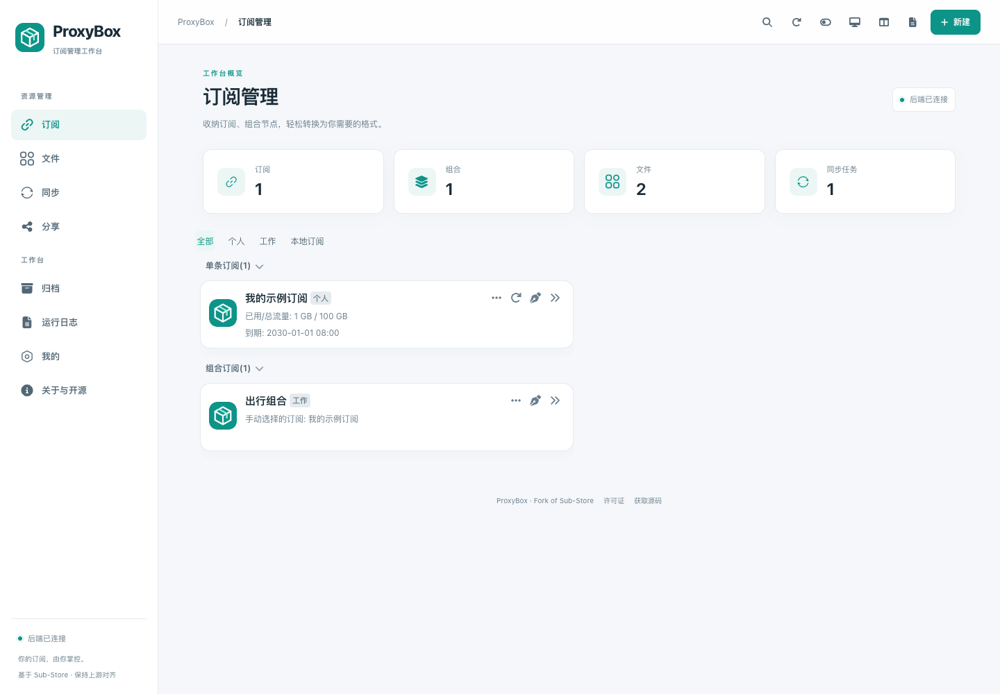
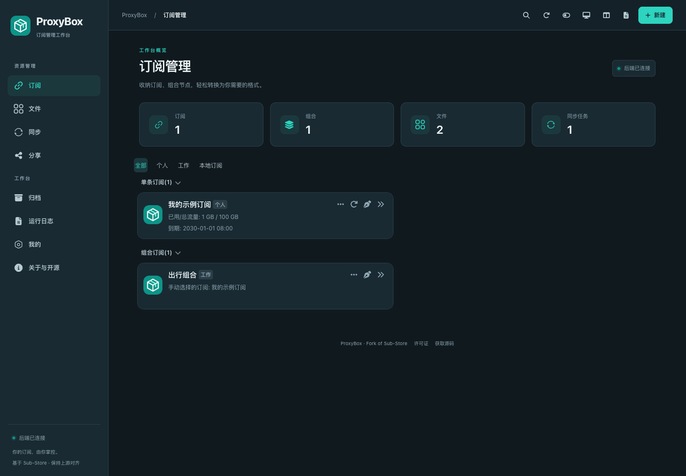
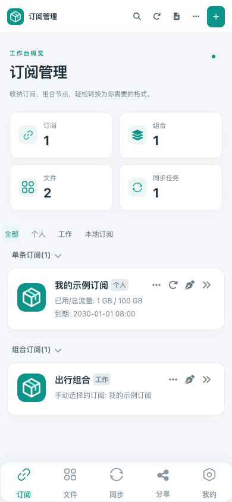

<p align="center"></p>
<h1 align="center">ProxyBox</h1>
<p align="center">你的订阅，由你掌控。<br>一个现代、可自托管的订阅管理工作台。</p>
<p align="center"><a href="#快速开始">快速开始</a> · <a href="docs/DEVELOPMENT.md">开发与部署</a> · <a href="docs/UPSTREAM.md">上游同步</a> · <a href="NOTICE.md">来源与许可</a></p>

> **ProxyBox fork 自 [SubStore / Sub-Store](https://github.com/sub-store-org/Sub-Store)，前端基于 [Sub-Store Frontend](https://github.com/sub-store-org/Sub-Store-Front-End)。本项目重构 UI，保留上游功能，并定期跟踪与对齐上游更新。它不是 Sub-Store 官方发行版。**
>
> 后端保留 **AGPL-3.0**，独立前端保留 **GPL-3.0**。原作者、许可证与第三方声明均保留；精确同步基线见 [upstream.json](upstream.json)，不以宣传代替实际兼容验证。

## 一个工作台，管理完整订阅流程

| 能力 | 你可以做什么 |
| --- | --- |
| 订阅与组合 | 管理远程/本地订阅，合并多个来源，按标签整理与拖拽排序 |
| 转换与处理 | 转换客户端格式，过滤、重命名、排序、去重、解析域名，以及脚本处理 |
| 文件与配置 | 托管远程/本地文件，编辑响应，生成 mihomo 配置并添加订阅节点 |
| 同步任务 | 生成订阅或文件产物，独立 Cron、批次同步与上游支持的 Gist 存储 |
| 分享与归档 | 创建独立分享链接，管理有效期/访问次数，归档、恢复、下载历史资源 |
| 运维与偏好 | 运行日志、请求与缓存设置、备份恢复、多后端管理、多语言与明暗主题 |

支持 JSON、Stash、mihomo / Clash.Meta、Surge / SurgeMac、Loon、Egern、Shadowrocket、QX、Surfboard、sing-box、V2Ray 与 URI 等输出。具体协议支持以当前后端为准；高级参数和脚本继续使用 Sub-Store 的接口契约。

## 界面预览

桌面工作台采用固定侧栏、清晰的信息层次与资源卡片；手机保留带文字的底部导航。编辑器、选择器、弹框、预览、日志、空态和错误态共用统一设计。



<details>
<summary>查看暗色与手机界面</summary>




</details>

预览使用隔离环境中的示例数据，不包含真实订阅或密钥。

## 快速开始

准备 `.node-version` 指定的 Node.js 与 `pnpm@11.0.9`，在仓库根目录执行：

```bash
corepack enable
pnpm --dir backend install --frozen-lockfile
pnpm --dir frontend install --frozen-lockfile
pnpm --dir backend bundle:esbuild
pnpm --dir frontend build
```

启动前后端合并服务：

```bash
SUB_STORE_BACKEND_API_HOST=127.0.0.1 \
SUB_STORE_BACKEND_API_PORT=3000 \
SUB_STORE_BACKEND_MERGE=true \
SUB_STORE_FRONTEND_BACKEND_PATH=/backend \
SUB_STORE_CORS_ALLOWED_ORIGINS=http://127.0.0.1:3000 \
SUB_STORE_FRONTEND_PATH="$PWD/frontend/dist" \
node backend/sub-store.min.js
```

打开 **http://127.0.0.1:3000**。默认使用同源 `/backend`，不默认连接公网 `sub.store`。可以在“我的 → 后端管理”连接其他后端。`/backend` 是示例路径，不是鉴权机制；外网部署请配置 TLS、实际站点的 CORS origin、受保护的管理入口及持久化数据目录，详见 [部署说明](docs/DEVELOPMENT.md)。

**兼容约定：** `SUB_STORE_*` 环境变量、API、数据键和 `sub-store.min.js` 等构建文件名继续保留，避免破坏已有脚本与模块。App 模块的上游下载地址仍指向上游版本，详见 [配置指南](config/README.md)。

## 开发与验证

```bash
# 终端一
cd backend
SUB_STORE_BACKEND_API_HOST=127.0.0.1 \
SUB_STORE_FRONTEND_BACKEND_PATH=/ \
SUB_STORE_CORS_ALLOWED_ORIGINS=http://localhost:8888,http://127.0.0.1:8888 \
pnpm esbuild:dev

# 终端二，在仓库根目录
pnpm --dir frontend dev
```

访问 `http://localhost:8888`。前端开发代理默认连接 `127.0.0.1:3000`；端口已占用时可用 `VITE_BACKEND_PROXY` 配置代理目标。

```bash
pnpm --dir backend test
pnpm --dir frontend check:locales
pnpm --dir frontend build
```

浏览器回归覆盖页面、桌面/手机、保存与失败恢复、转换预览、分享、归档、备份、明暗主题、许可证与源码入口；只能在隔离测试服务运行，详见 [UI 覆盖与验证](docs/UI-COVERAGE.md)。

## 定期跟踪上游

```bash
node tools/upstream.mjs check
```

工具分别检查前后端的最新提交；GitHub Actions 每周保存检查报告。后端保留共同 Git 历史进行 merge，前端按固定基线进行三方补丁合并，保留 ProxyBox UI 定制。更新需要复核冲突与功能，检查不会自动合并、强推或发版。完整操作见 [上游维护流程](docs/UPSTREAM.md)。

## 项目结构

```text
backend/       Sub-Store 兼容后端与测试
frontend/      完整前端源码、ProxyBox UI 与原 GPL 许可
config/        上游 App 模块与兼容配置说明
scripts/       上游示例处理脚本
tools/         上游检查、源码打包与浏览器验证
docs/          开发、许可、同步、变更与验证文档
AGENTS.md      后续开发必须遵守的项目约定
upstream.json  两套上游的精确版本基线
```

## 来源、许可证与贡献

- 原作者与贡献者：Sub-Store / Sub-Store Frontend 团队，后端原作者 Peng-YM；其他作者署名保留在对应源码中。
- 原始许可证：[AGPL-3.0](LICENSE)、[GPL-3.0](frontend/LICENSE)。软件不提供担保；可按适用许可证复制、修改与再分发。
- ProxyBox 修改说明及日期：[NOTICE.md](NOTICE.md)、[修改记录](docs/CHANGELOG.md)。
- 分发或运行修改后的网络服务时，须提供实际运行版本的对应源码。构建会生成源码包，界面页脚与关于页提供下载入口；部署方须验证链接可用及版本一致。详见 [许可合规说明](docs/LICENSE-COMPLIANCE.md)。
- 贡献前请阅读 [贡献指南](CONTRIBUTING.md) 与 [AGENTS.md](AGENTS.md)；问题和改进在 [ProxyBox 仓库](https://github.com/yuhuotech/proxy-box) 讨论。

感谢 Sub-Store 生态贡献者，以及原项目致谢的 KOP-XIAO、Orz-3、58xinian。上游技术参考：[文档](https://sub-store-org.github.io/doc)、[Wiki](https://github.com/sub-store-org/Sub-Store/wiki)。
